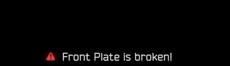

# ShowMeThePlates

## Preview


**See the condition of your armor plates and helmet inserts at a glance, in raid and in your inventory, without opening a single menu.**

ShowMeThePlates is a client-side BepInEx plugin for SPT 4.1. It adds a small, clean panel to your screen that shows the durability of every plate in your vest and every insert in your helmet. It also writes the same information on top of the item icons in your inventory, stash and loot, and warns you the moment a plate breaks.

> Requires SPT 4.1.x. Client-only: nothing to install on the server.

---

## Features

### 1. In-raid panel
- Shows your **vest and helmet** silhouettes, filled up according to how much durability they have left.
- Lists **each plate** (Front, Rear, Left side, Right side) and **each helmet insert** (Top, Nape, Eyes, Jaw, Ears) with its durability.
- **Auto Hide mode** (default): the panel stays out of your way and appears only when it matters:
  - when a plate or insert **loses durability** (you got hit),
  - when you **hold the show key** (R by default) for half a second,
  - while any component is below your **low durability threshold** (optional).
- Plates and inserts that just took damage **flash soft red** for a few seconds, so you can tell which one was hit.
- The panel **hides itself automatically in menus** and while the mouse cursor is free (inventory, pause, etc.).


### 2. Break alert
- When a plate or insert reaches **0 durability** you get a red T*****-style notification and a **sound**, so you know you are no longer protected there even in the middle of a fight.
- The alert can also be shown as blinking text under the panel (**Alert type**).



### 3. Inventory overlay
- Every vest or helmet icon in your inventory, stash and loot shows a **small list of its plates / inserts** with their durability, color coded, e.g. `F 56`, `R 60`, `LS 40`.
- The **armor class badge** (the game's own III, IV, V, VI icons) appears next to each line.
- Hover an item and the **tooltip lists every plate and insert** with its class and durability.
- Handy when you are comparing carriers at the flea market or deciding which plates to put in which vest.

### 4. Everything is configurable
Press **F12** and look for **ShowMeThePlates**. You can move the panel, resize it, change the text size, turn the glow and the damage flash on or off, pick when it appears, and decide what the inventory overlay shows. Every option has a description.

---

## Installation
1. Download the latest release.
2. Extract it into your SPT folder, so that you end up with:

```
BepInEx/plugins/ShowMeThePlates/ShowMeThePlates.dll
BepInEx/plugins/ShowMeThePlates/Broken_Plate_Sound.wav
```

3. Start the game. Press **F12** to change settings.

To uninstall, delete the `ShowMeThePlates` folder.

---

## How to read it

### Plate letters
| Text | Meaning |
|------|---------|
| **F** | Front plate |
| **R** | Rear (back) plate |
| **LS** | Left side plate |
| **RS** | Right side plate |

### Helmet letters
| Text | Meaning |
|------|---------|
| **T** | Top |
| **N** | Nape |
| **E** | Eyes |
| **J** | Jaw |
| **Ea** | Ears |
| **G** | **Gear**: any armored extra piece attached to the helmet, like the faceshield of the Altyn or the visor of other helmets. |

Only the parts your item actually has are shown. A vest with only front and rear plates will show just `F` and `R`.

### Colors
By default the fill level tells you the story and the text stays white. Turn on **Color by wear** and it turns green, yellow, orange and finally red as the durability drops. In the inventory the numbers are always color coded.

---

## Settings overview (F12)

| Section | What it controls |
|---------|------------------|
| **1. General** | When the panel appears (Auto Hide / Always On), the show key, how long it stays visible, damage trigger, low durability threshold, raid only, hide in menus. |
| **2. Panel** | Position, scale, icon and text size, opacity, fade, glow, color by wear, damage flash. |
| **3. Helmet** | Show the helmet total and inserts, and where to place the helmet block. |
| **4. Alerts** | Alert on break, alert type (notification / panel / both), alert duration, sound volume. |
| **6. Inventory** | Durability text on icons, tooltip, armor class badges, background, text size. |

---

## Compatibility and notes
- Built for **SPT 4.1.x** (EFT 0.16.9). Client-side only.
- Works with vests and helmets from other mods as long as their plate slots are named like the vanilla ones (the slot name contains `plate`) and their inserts follow the vanilla helmet slots.
- It is light: it reads the equipment twice per second and does nothing outside a raid except update the inventory icons.
- Not tested with Fika. If you try it there, please report how it goes.
- It works with mods that let you wear an armored rig on top of a body armor. It just create a second F and R plate line.

## Reporting problems
Include your `BepInEx/LogOutput.log` (or `Player.log`), the item you were using, and a screenshot of the panel.

## AI disclosure
I am not a programmer. This mod was written together with an AI assistant (Claude), following my directions: I decided what it should do, how it should look and behave, tested it in the game, and reported what was wrong, and the AI wrote the code and fixed it from that feedback.

That means the code may not look like what an experienced developer would write, and there may be bugs I did not find. If something breaks, please reach out thru discord with your issue, your log and what you were doing, and I will do my best to fix it.

## Credits and license
Made by **thisfkngletters**.

The **code** is released under the [MIT License](LICENSE).

**Not covered by MIT:** `Broken_Plate_Sound.wav` is a modified sound from a video game and belongs to its original rights holder. It is included for non-commercial fan use only and will be removed on request. The mod works without it: delete the file and the plugin plays the game's own alert sound instead.

## 1.0.0
- First public release.
